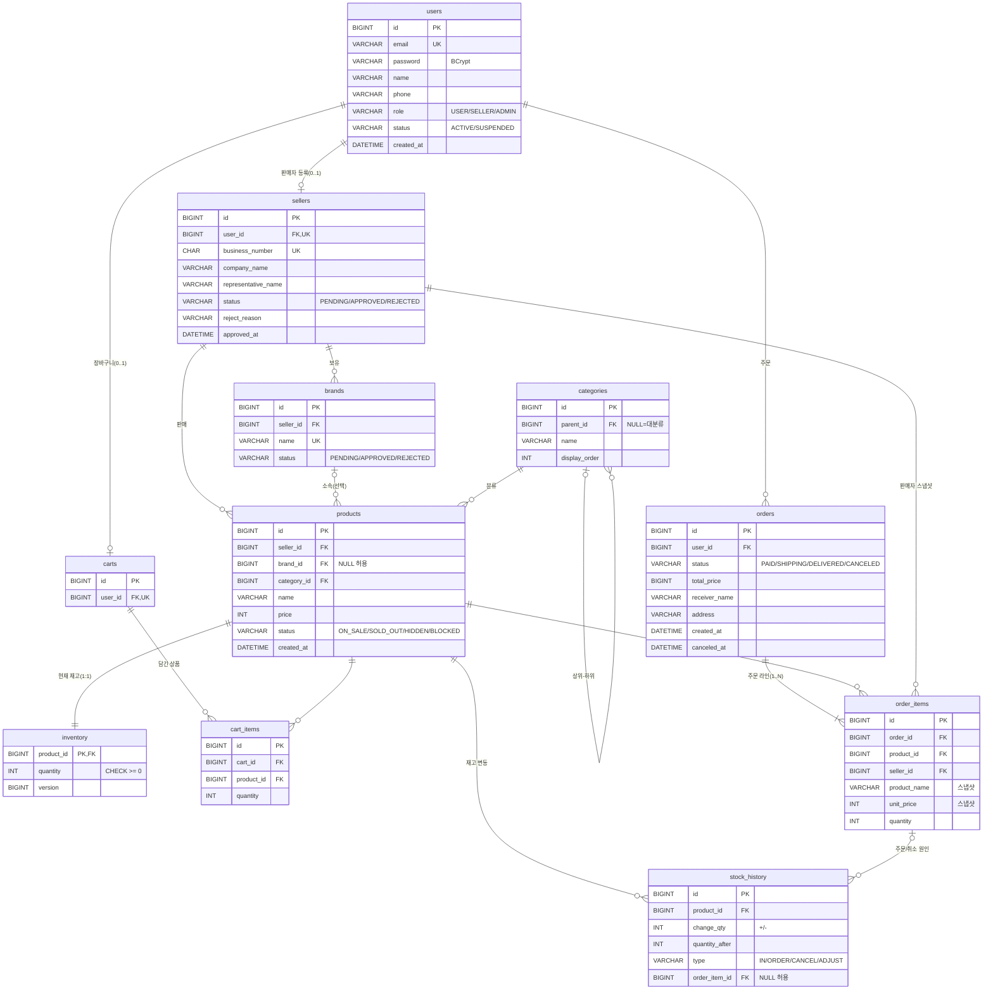

# 멀티 셀러 쇼핑몰 — Backend

Spring Boot 3.5 · Java 17 · MySQL 8.0 · Flyway · Spring Security(JWT) · springdoc-openapi

- 요구사항: [`docs/명세서.md`](docs/명세서.md)
- API 문서: 앱 실행 후 http://localhost:8080/swagger-ui.html

목차: [1. 실행](#1-실행) · [2. 테스트](#2-테스트) · [3. 패키지 구조](#3-패키지-구조) · [4. DB 설계](#4-db-설계) · [5. 인덱스와 실행 계획](#5-인덱스와-실행-계획-explain) · [6. 변경 이력과 남은 작업](#6-변경-이력과-남은-작업)

---

## 1. 실행

### 1.1 DB 준비

**방법 A — Docker (권장).** Docker Desktop만 있으면 됩니다. 호스트 포트는 **3308**입니다.

```bash
docker compose up -d                          # MySQL만 (앱은 IDE / gradlew로 실행)
docker compose --profile app up -d --build    # MySQL + 앱 같이 (시연용, http://localhost:8080)
docker compose down                           # 중지 (데이터 유지)
docker compose down -v                        # 중지 + 데이터 삭제 (DB 초기화)
```

첫 실행 때 `shop`(개발), `shop_test`(DB 테스트) 데이터베이스와 `shop / shop1234` 계정이 자동으로 만들어집니다.

**방법 B — 직접 설치한 MySQL 8.0.** root 계정으로 한 번 실행합니다.

```bash
mysql -h 127.0.0.1 -P 3307 -u root -p < scripts/init-db.sql
```

어느 방법이든 테이블·카테고리·시연 데이터는 앱이 시작할 때 Flyway가 자동으로 넣습니다.

### 1.2 앱 실행

```bash
./gradlew bootRun
```

앱 기본 설정은 `localhost:3307`(방법 B)입니다. Docker DB(3308)를 쓰려면 `DB_URL`을 지정합니다.

```powershell
# PowerShell
$env:DB_URL="jdbc:mysql://localhost:3308/shop?serverTimezone=Asia/Seoul&characterEncoding=UTF-8&allowPublicKeyRetrieval=true&useSSL=false"; ./gradlew bootRun
```

> 앱 컨테이너(`--profile app`)가 떠 있으면 8080 포트가 겹칩니다. 먼저 `docker compose stop app`으로 끄세요.

| 환경변수 | 기본값 |
| --- | --- |
| `DB_URL` | `jdbc:mysql://localhost:3307/shop?...` |
| `DB_USERNAME` / `DB_PASSWORD` | `shop` / `shop1234` |
| `JWT_SECRET` | 개발용 고정값 (배포 시 반드시 변경, 32바이트 이상) |
| `ADMIN_EMAIL` / `ADMIN_PASSWORD` | `admin@shop.com` / `admin1234!` |
| `SPRING_PROFILES_ACTIVE` | `local` (시연 데이터 포함). `prod`면 시연 데이터 미적용 |

### 1.3 시연 계정 (`local` 프로필)

관리자 계정은 앱 시작 시 없으면 자동 생성됩니다. 나머지는 `db/demo/R__demo_data.sql`이 넣으며 비밀번호는 모두 `demo1234!`입니다.

| 계정 | 역할 | 내용 |
| --- | --- | --- |
| `admin@shop.com` / `admin1234!` | 관리자 | 판매자·브랜드 승인, 카테고리·회원·상품 관리 |
| `store.a@demo.com` | 판매자 (승인) | 어반스타일 — 브랜드 URBAN BASIC, URBAN STEP, 상품 15개 |
| `store.b@demo.com` | 판매자 (승인) | 테크마켓 — 브랜드 TECHON, TECHON PRO(승인 대기), 상품 16개 |
| `store.c@demo.com` | 일반 회원 (판매자 신청 대기) | 관리자 승인 시연용 |
| `buyer1@demo.com`, `buyer2@demo.com` | 일반 회원 | |

재고 0 상품(품절 표시), 수동 품절(SOLD_OUT), 숨김(HIDDEN) 상품이 섞여 있습니다. 주문 데이터는 BE-2 주문 기능 완성 후 추가합니다.

> 관리자 id는 1이라는 보장이 없습니다(시연 데이터가 먼저 들어가면 id가 뒤로 밀림). FE·스크립트에서 id를 가정하지 마세요.

---

## 2. 테스트

```bash
./gradlew test
```

- 단위·보안 테스트는 DB 없이 실행됩니다.
- **DB 테스트**는 `DB_TEST_URL`이 있을 때만 실행됩니다: DB 제약 검증 13개(`SchemaConstraintTest`), 같은 이메일 동시 가입 10건(`ConcurrentSignupTest`).

```powershell
# PowerShell (Docker DB 기준. 직접 설치한 MySQL이면 3307)
$env:DB_TEST_URL="jdbc:mysql://localhost:3308/shop_test?allowPublicKeyRetrieval=true&useSSL=false"; ./gradlew test --rerun
```
```bash
# Git Bash
DB_TEST_URL="jdbc:mysql://localhost:3308/shop_test?allowPublicKeyRetrieval=true&useSSL=false" ./gradlew test --rerun
```

Gradle은 환경변수 변화를 입력값으로 보지 않아 이전 결과(DB 테스트 skip)를 재사용하므로 `--rerun`이 필요합니다.

H2 대신 실제 MySQL로 테스트하는 이유: CHECK·복합 FK·REGEXP 동작이 MySQL과 달라, H2에서 통과해도 DB 제약을 검증한 것이 아니기 때문입니다.

---

## 3. 패키지 구조

```
com.ssu.shop
├── global      config(Security, Swagger, CORS, 관리자 초기화) / security(JWT) / common(응답, 페이징) / error
└── domain
    ├── user      회원가입·로그인·내 정보, 관리자 회원 관리          (BE-1)
    ├── seller    판매자 신청·승인                                (BE-1)
    ├── brand     브랜드 등록·승인·공개 페이지                     (BE-1)
    ├── category  카테고리 트리·관리                               (BE-1)
    ├── product   상품 조회·등록·수정, 관리자 차단                  (BE-1)
    ├── inventory 재고·재고 이력 엔티티 (로직은 BE-2)
    ├── cart      엔티티 골격 (BE-2)
    └── order     엔티티 골격 (BE-2)
```

```
src/main/resources
├── db/migration
│   ├── V1__init.sql                        테이블 11개 + PK/FK/UK/CHECK 제약
│   ├── V2__seed_categories.sql             카테고리 (대분류 5 × 소분류 3)
│   └── V3__tune_product_list_indexes.sql   상품 목록 인덱스 개선 (5장)
└── db/demo
    └── R__demo_data.sql                    시연 데이터 (local 프로필만)
```

---

## 4. DB 설계

### 4.1 설계 원칙

1. **정규화 기본 (3NF 이상).** 하나의 사실은 한 곳에만 저장해 삽입·수정·삭제 이상을 막는다.
2. **반정규화는 "시간이 지나도 변하면 안 되는 값"에만.** 주문 당시 가격·상품명처럼 원본이 바뀌어도 과거 기록은 그대로여야 하는 값은 복사(스냅샷)하는 것이 오히려 정확하다.
3. **무결성은 DB가 최후 방어선.** 애플리케이션 버그나 동시 요청이 있어도 DB 제약(PK·FK·UNIQUE·NOT NULL·CHECK)이 잘못된 데이터를 거부하게 한다. DB로 표현할 수 없는 규칙만 서비스 계층에서 검증한다.
4. **물리 삭제 최소화.** 주문 이력이 참조하는 회원·상품·판매자는 지우지 않고 상태값으로 비활성화한다. FK는 기본 `RESTRICT`.
5. **네이밍.** 테이블은 복수형 snake_case(`users`, `orders` — `USER`, `ORDER`는 예약어), PK는 `id`, FK는 `{참조 단수}_id`, 제약 이름은 `pk_/fk_/uk_/ck_/idx_` 접두어.

### 4.2 ERD



전체 컬럼과 제약은 [`V1__init.sql`](src/main/resources/db/migration/V1__init.sql)에 있습니다.

### 4.3 관계와 구현 방법

| 관계 | 카디널리티 | DB 구현 | 이유 |
| --- | --- | --- | --- |
| users – sellers | 1 : 0..1 | `sellers.user_id` FK + **UNIQUE** | FK만 있으면 1:N이 된다. UNIQUE로 "회원당 판매자 정보 최대 1개"를 DB가 보장 |
| users – carts | 1 : 0..1 | `carts.user_id` FK + **UNIQUE** | 같은 이유 |
| products – inventory | 1 : 1 | `inventory.product_id`가 **PK이자 FK** (식별 관계) | 별도 id를 두면 UNIQUE를 또 걸어야 한다. PK = FK면 1:1이 구조적으로 보장되고 PK 검색 1회로 조회 |
| brands – products | 0..1 : 0..N | `products.brand_id` FK **NULL 허용** | NULL = 브랜드 없는 독립 상품 |
| categories – categories | 0..1 : 0..N | `parent_id` 자기참조 FK | NULL = 대분류. 2단계(대분류 > 소분류), 상품은 소분류에만 등록 |
| orders – order_items | 1 : 1..N | `order_items.order_id` FK | "최소 1개"는 DB로 표현할 수 없어 주문 서비스에서 검증 |
| order_items – stock_history | 0..1 : 0..N | `order_item_id` FK NULL 허용 | 입고·조정 이력은 주문과 무관 |

### 4.4 정규화와 의도적 반정규화

모든 테이블의 함수 종속성을 점검해 3NF(대부분 BCNF)를 만족합니다. 예외는 아래 두 가지이고, 둘 다 이유가 있습니다.

**products의 `brand_id → seller_id`.** 브랜드가 있으면 brand_id로 판매자를 알 수 있어 이행 종속이 생깁니다. 하지만 브랜드 없는 상품은 seller_id를 따로 저장해야 하고, "상품 소유자"는 브랜드와 별개의 사실이라 지울 수 없습니다. 대신 둘이 어긋나지 않도록 **복합 FK로 강제**했습니다(4.5).

**반정규화한 컬럼**

| 컬럼 | 원본 | 이유 | 갱신 이상이 없는 이유 |
| --- | --- | --- | --- |
| `order_items.unit_price` | `products.price` | 주문 당시 가격 보존. 가격이 바뀌어도 과거 주문·매출은 그대로여야 함 | 생성 후 수정하지 않음 |
| `order_items.product_name` | `products.name` | 구매 당시 상품명 표시 | 생성 후 수정하지 않음 |
| `order_items.seller_id` | `products.seller_id` | 판매자 통계를 products 조인 없이 집계 | 상품의 판매자는 변경 불가 정책 |
| `orders.total_price` | Σ(quantity × unit_price) | 목록마다 SUM 하지 않음, 금액 검증 기준 | 주문 라인은 수정 없음 |
| `stock_history.quantity_after` | 이력 누적합 | "변동 후 재고" 표시, 현재 재고와 대조해 정합성 검사 | 이력은 INSERT만 |
| `users.role = SELLER` | `sellers.status = APPROVED` | 권한 체크를 users 한 테이블로 | 승인 시 같은 트랜잭션에서 함께 갱신 |

반정규화한 값은 전부 **한 번 쓰고 바뀌지 않거나, 같은 트랜잭션에서 함께 갱신되는 값**입니다.

배송지는 `addresses` 테이블로 분리하지 않고 `orders`에 값으로 저장합니다. 주문 배송지는 주문 시점의 값이어야 하기 때문입니다.

### 4.5 핵심 설계 결정

**① "브랜드의 판매자 = 상품의 판매자"를 복합 FK로 강제**

```sql
-- brands: (id, seller_id)를 참조 대상으로 만든다
CONSTRAINT uk_brands_id_seller UNIQUE (id, seller_id)
-- products: (brand_id, seller_id) 쌍이 brands에 실제로 있어야 한다
CONSTRAINT fk_products_brand_seller FOREIGN KEY (brand_id, seller_id) REFERENCES brands (id, seller_id)
```

판매자 A의 상품에 판매자 B의 브랜드를 넣으면 `(brandB, sellerA)` 쌍이 없어서 INSERT가 거부됩니다. `brand_id`가 NULL이면 FK 검사를 하지 않아 브랜드 없는 상품은 허용됩니다. 서비스 검증(`403 BRAND_NOT_OWNED`)은 이해하기 쉬운 에러 메시지를 위해 함께 둡니다.

**② 재고를 products와 분리 (inventory 1:1)**

1. **락 범위 분리**: 주문은 `inventory` 행만, 상품 정보 수정은 `products` 행만 잠근다.
2. **변경 빈도 차이**: 주문마다 바뀌는 재고를 작은 행에 모아 UPDATE 비용을 줄인다.
3. **낙관적 락 범위**: `version`이 products에 있으면 상품 설명만 고쳐도 주문이 충돌한다.
4. `CHECK (quantity >= 0)`은 어떤 동시성 방식을 쓰든 **음수 재고를 막는 마지막 방어선**이다.

**③ 상태값은 ENUM 대신 VARCHAR + CHECK.** MySQL `ENUM`은 값 추가 시 `ALTER TABLE`이 필요하고 내부 순서 번호로 비교·정렬됩니다. VARCHAR + CHECK는 표준 SQL이고 값이 읽히는 그대로 저장됩니다. JPA는 `EnumType.STRING`으로 매핑합니다.

**④ 상품 상태에 `BLOCKED` 추가, 품절은 조회 시 판정**
- `HIDDEN`(판매자 숨김)과 `BLOCKED`(관리자 차단)를 구분합니다. 하나로 쓰면 관리자가 숨긴 상품을 판매자가 다시 공개할 수 있습니다.
- 품절 표시는 `status = 'SOLD_OUT' OR inventory.quantity = 0`으로 조회할 때 판정합니다. 재고 0마다 products.status를 바꾸면 주문 트랜잭션이 products 행까지 잠가야 하고, 같은 사실을 두 곳에 저장하게 됩니다.

**⑤ 삭제 정책**

| 데이터 | 정책 | 이유 |
| --- | --- | --- |
| users, sellers, products | 물리 삭제 안 함 → 상태값(SUSPENDED / HIDDEN / BLOCKED) | 주문·이력이 참조. FK RESTRICT가 실수로 지우는 것도 막음 |
| categories | 삭제 가능, 단 상품·하위 카테고리가 있으면 거부(`409 CATEGORY_IN_USE`) | FK RESTRICT |
| cart_items, inventory | 부모 삭제 시 CASCADE | 부모에 종속된 데이터 |

`ON DELETE SET NULL`은 쓰지 않습니다. 예를 들어 `order_items.product_id`가 NULL이 되면 무엇이 팔렸는지 알 수 없게 됩니다.

### 4.6 DB 제약 목록

| 규칙 | 제약 |
| --- | --- |
| 이메일·사업자번호·브랜드명 중복 금지, 회원당 판매자 1개·장바구니 1개 | UNIQUE |
| 장바구니 같은 상품 중복 금지 / 같은 부모 아래 카테고리 이름 중복 금지 | UNIQUE(cart_id, product_id) / UNIQUE(parent_id, name) |
| 상품의 브랜드는 같은 판매자 소유 | 복합 FK |
| 재고·가격·수량 음수 불가 | CHECK |
| 사업자번호는 숫자 10자리 | CHECK (REGEXP) |
| 재고 이력 부호 (IN·CANCEL은 +, ORDER는 −), ORDER·CANCEL은 주문 라인 참조 필수 | CHECK |
| 취소 상태 ⇔ `canceled_at` 존재 | CHECK |

모든 제약은 `SchemaConstraintTest`에서 실제 MySQL로 위반 시 거부되는지 검증합니다.

### 4.7 데이터 타입

| 항목 | 선택 | 이유 |
| --- | --- | --- |
| PK | `BIGINT AUTO_INCREMENT` | 순차 증가라 클러스터드 인덱스 끝에만 추가(페이지 분할 적음). UUID는 랜덤 삽입으로 분할이 많음 |
| 금액 | `INT`(단가), `BIGINT`(합계) | 원 단위 정수. `FLOAT/DOUBLE`은 오차 |
| 시각 | `DATETIME(6)` | `TIMESTAMP`는 2038년 한계와 자동 타임존 변환. 타임존은 Asia/Seoul로 고정 |
| 문자셋 | `utf8mb4` / `utf8mb4_0900_ai_ci` | 한글·이모지 저장. 대소문자 무시 콜레이션이라 이메일 UNIQUE를 대소문자로 우회할 수 없음 |

### 4.8 스키마 관리: Flyway + `ddl-auto=validate`

- JPA 자동 생성(`create/update`)은 CHECK·복합 FK·제약 이름·인덱스 컬럼 순서를 원하는 대로 만들지 못합니다. SQL 파일로 관리하면 **설계한 DDL = 실제 DB**가 되고 변경 이력이 남습니다.
- `validate`라서 엔티티와 테이블이 어긋나면 앱이 시작 단계에서 실패합니다.
- **스키마를 바꿀 때는 이미 적용된 V 파일을 고치지 말고 새 V 파일(V4, V5 …)을 추가합니다.** Flyway가 적용된 파일의 체크섬을 검사합니다.

---

## 5. 인덱스와 실행 계획 (EXPLAIN)

### 5.1 상품 목록 인덱스

| 인덱스 | 쓰는 쿼리 |
| --- | --- |
| `products(category_id, created_at)` | 소분류 최신순 — 등호 조건 뒤에 정렬 컬럼 |
| `products(created_at)` | 전체·대분류 최신순 (메인 화면 기본) |
| `products(price)` | 전체 가격순 |
| `products(seller_id, created_at)` | 판매자 내 상품 목록 |
| `products(brand_id, seller_id)` | 브랜드 페이지 (복합 FK가 자동 생성) |

BE-2용으로 `orders(user_id, created_at)`, `orders(created_at, status)`, `order_items(product_id)`, `order_items(seller_id, order_id)`, `stock_history(product_id, created_at)`이 V1에 있습니다. BE-2 쿼리 확정 후 EXPLAIN으로 다시 확인합니다.

### 5.2 처음 설계(V1)의 문제와 개선(V3)

처음에는 `(category_id, status, created_at)`, `(status, price)`로 설계했습니다. 상품 5만 건으로 측정하니 메인 화면 쿼리가 **풀스캔 + filesort**였습니다.

1. **status는 선택도가 낮다.** 공개 상품(ON_SALE, SOLD_OUT)이 약 95%라 거의 걸러지지 않는다.
2. **`status IN (2개 값)`은 범위 조건이다.** 복합 인덱스에서 범위 조건 뒤의 컬럼은 정렬 순서를 이어 쓸 수 없어, 두 구간을 합친 뒤 다시 정렬한다.

**개선 원칙: 등호 조건 컬럼 → 정렬 컬럼. 선택도가 낮은 status는 인덱스에서 빼고 읽으면서 거른다.**

- InnoDB 보조 인덱스는 끝에 PK를 포함하므로 `(created_at)`은 실제로 `(created_at, id)`이고, `ORDER BY created_at DESC, id DESC`를 역순 스캔만으로 처리합니다.
- `LIMIT 20`을 인덱스 순서대로 읽다가 20건을 채우면 바로 멈춥니다.
- 정렬 보조키 방향을 주 키와 맞췄습니다. `price ASC, id DESC`처럼 섞이면 filesort가 다시 생기므로 가격 낮은순은 `price ASC, id ASC`입니다.

### 5.3 측정 결과 (MySQL 8.0, 상품 50,000건)

| 쿼리 | V1 | V3 | 읽은 행 | 실제 시간 |
| --- | --- | --- | --- | --- |
| 전체 최신순 (메인 기본) | 풀스캔 + filesort | `idx_products_created` 역순 스캔 | 50,000 → **21** | 175 ms → **0.19 ms** |
| 전체 가격 낮은순 | 풀스캔 + filesort | `idx_products_price` 정순 스캔 | 50,000 → **20** | 185 ms → **0.13 ms** |
| 소분류 최신순 | range + filesort | `idx_products_category_created` 역순 | 2,500 → **27** | 28.7 ms → **0.20 ms** |
| 대분류 최신순 (하위 3개) | — | `idx_products_created` 역순 + 필터 | **105** | **0.59 ms** |

```
-- V1: 전체 최신순
type=ALL  key=NULL  rows=49885  Extra=Using where; Using filesort
-> Sort: p.created_at DESC, p.id DESC   (actual time=174)
   -> Table scan on p                   (rows=50000)

-- V3: 전체 최신순
type=index  key=idx_products_created  rows=20  Extra=Using where; Backward index scan
-> Index scan on p using idx_products_created (reverse)  (rows=21, actual time=0.13)
```

### 5.4 트레이드오프

- **status 분포에 기댄 설계입니다.** HIDDEN·BLOCKED가 대다수가 되면 20건을 채우기까지 많은 행을 건너뜁니다.
- **쓰기 비용**: 인덱스가 3개 → 4개. 상품은 읽기가 훨씬 많아 감수할 만합니다.
- **키워드 검색은 풀스캔**입니다. `LIKE '%키워드%'`는 B-Tree를 못 씁니다. 필요하면 ngram FULLTEXT로 바꿉니다.

### 5.5 N+1 확인

`GET /api/products` 한 번에 쿼리 2~3개입니다: ① products + brands + categories JOIN ② inventory `WHERE product_id IN (...)` ③ count. 브랜드·카테고리는 `@EntityGraph` fetch join으로, 재고는 IN 일괄 조회로 가져와서 상품 수와 상관없이 일정합니다.

---

## 6. 변경 이력과 남은 작업

### 6.1 변경 이력

| 날짜 | 변경 | 이유 |
| --- | --- | --- |
| 11-09 | 상품 목록 인덱스 재설계 (`V3__tune_product_list_indexes.sql`) | 5만 건 EXPLAIN에서 풀스캔 + filesort 발견 (5장) |
| 11-09 | 가격 낮은순 보조 정렬 `id DESC` → `id ASC` | 인덱스 순서와 방향을 맞춰 filesort 제거 |
| 11-09 | 하위 카테고리 조회를 JPQL로 변경 | 파생 쿼리가 불필요한 self-join 생성 |
| 11-09 | 시연 데이터, 동시 가입 테스트 추가 | 시연 준비, UNIQUE 제약의 동시성 방어 확인 |
| 11-09 | Docker 구성 (`docker-compose.yml`, `Dockerfile`) | 팀원 환경 통일, 다른 프로젝트 DB와 분리 |

### 6.2 검증 결과 (2026-11-09)

| 항목 | 결과 |
| --- | --- |
| 자동 테스트 | 39개 통과 (DB 제약 13, 동시 가입 1, 보안 8, 서비스 14, JWT 3) — 로컬 MySQL·Docker MySQL 모두 |
| API 시나리오 | 48개 통과 — 가입 → 판매자 승인 → 브랜드 → 상품 → 관리자 차단·정지, 에러 케이스 포함 (로컬 실행·앱 컨테이너 모두) |
| 데이터 정합성 | 재고 행 없는 상품 0건, 재고 ≠ 마지막 이력 0건, role ≠ 판매자 상태 0건 |

### 6.3 남은 작업

| 항목 | 담당 | 내용 |
| --- | --- | --- |
| 시연 주문 데이터 | BE-1 + BE-2 | 최근 90일 주문 300건 내외, inventory·stock_history와 일치하게 생성 후 정합성 검증 |
| BE-2 쿼리 인덱스 검증 | BE-2 (BE-1 지원) | 주문·통계·재고 이력 쿼리 EXPLAIN, 필요하면 V4 |
| 팀 확정 반영 | BE-1 | 명세서의 [팀 확인] 항목이 제안과 다르면 V4~로 반영 |
| 2차 과제 | — | ngram FULLTEXT 검색, `order_items.status`(판매자별 배송), `daily_sales` 집계 테이블 |
