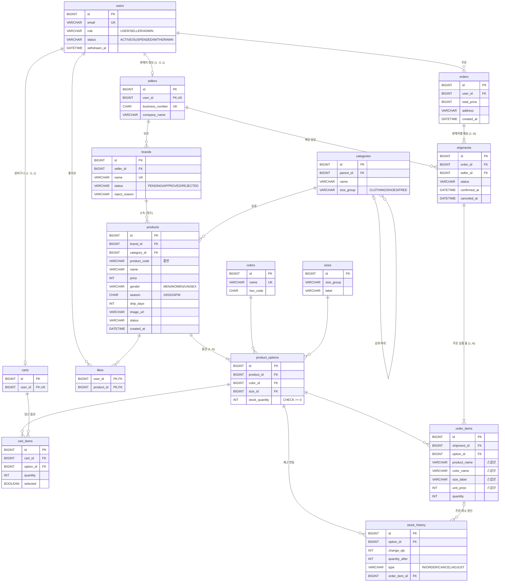

# 패션 멀티 셀러 쇼핑몰 — Backend

Spring Boot 3.5 · Java 17 · MySQL 8.0 · Flyway · Spring Security(JWT) · springdoc-openapi

무신사를 참고한 패션 전용 쇼핑몰입니다. 판매자가 브랜드와 상품을 등록하면 관리자가 승인하고, 승인된 상품만 구매자에게 보입니다.

- 요구사항: [`docs/명세서.md`](docs/명세서.md)
- API 문서: 앱 실행 후 http://localhost:8080/swagger-ui.html

목차: [작업 현황](#작업-현황-트랙별) · [1. 실행](#1-실행) · [2. 테스트](#2-테스트) · [3. 패키지 구조](#3-패키지-구조) · [4. DB 설계](#4-db-설계) · [5. 인덱스와 실행 계획](#5-인덱스와-실행-계획-explain) · [6. 변경 이력과 남은 작업](#6-변경-이력과-남은-작업)

---

## 작업 현황 (트랙별)

> 마지막 갱신: 2026-11-14 · 담당은 역할 분담 **안**(BE-1: 좋아요·통계·시연 데이터, BE-2: 재고·장바구니·주문)이며 팀 확정 전입니다.
> 갱신 방법: 끝난 항목의 `- [ ]`를 `- [x]`로 바꾸고, 요약 표의 진행 수와 위의 갱신 날짜를 고칩니다. 새 작업은 해당 트랙에 줄을 추가합니다.

| 트랙 | 담당 | 진행 | 상태 |
| --- | --- | --- | --- |
| [A. 공통 기반·인프라](#a-공통-기반인프라) | BE-1 | 6 / 9 | 🔶 거의 완료 |
| [B. DB 설계·데이터](#b-db-설계데이터) | BE-1 | 6 / 6 | ✅ 완료 |
| [C. 회원·판매자](#c-회원판매자) | BE-1 | 4 / 4 | ✅ 완료 |
| [D. 브랜드·상품](#d-브랜드상품) | BE-1 | 5 / 5 | ✅ 완료 |
| [E. 좋아요](#e-좋아요) | BE-1 | 3 / 3 | ✅ 완료 |
| [F. 재고](#f-재고) | BE-2 | 2 / 3 | 🔶 서비스 완료, API 남음 |
| [G. 장바구니](#g-장바구니) | BE-2 | 1 / 2 | 🔶 DB만 완료 |
| [H. 주문·배송](#h-주문배송) | BE-2 | 1 / 6 | 🔶 DB만 완료 |
| [I. 통계](#i-통계) | BE-1 | 4 / 4 | ✅ 완료 |
| [팀 결정](#팀-결정) | 팀 | 0 / 4 | ⬜ |

순서: **F(재고 변경 서비스) → H(주문)**. I(통계)는 B의 시연 주문 데이터가 있으면 H를 기다리지 않고 시작할 수 있습니다.

### A. 공통 기반·인프라
- [x] 프로젝트 설정, Spring Security + JWT, 공통 응답·예외 처리
- [x] Swagger, CORS
- [x] 이미지 업로드 (서버 폴더 저장, `/api/seller/images`)
- [x] Docker 구성 (MySQL + 앱)
- [x] GitHub 저장소, 패키지명 `com.ssu.shop`
- [x] 회원제: 가입·로그인 외 로그인 필수
- [ ] 앱 컨테이너 이미지를 V4 코드로 다시 빌드해 확인
- [ ] 샘플 이미지 22장 준비 (`src/main/resources/static/images/samples/`, 파일명은 [1.3](#13-시연-계정-local-프로필)) — 팀
- [ ] 배포 방식 결정 (로컬 시연 / 클라우드) — 팀

### B. DB 설계·데이터
- [x] 스키마 V1~V4 (테이블 14개, 제약조건), DB 제약 테스트 18개
- [x] 시연 데이터: 회원·판매자·브랜드·상품 27개와 옵션·좋아요
- [x] ERD·설계 근거 정리 (4장), 명세서 DB 확정안
- [x] 시연 주문 데이터 (90일치, `R__demo_orders.sql`) + 정합성 검사 15종 (`scripts/check-integrity.sql`)
- [x] 대량 데이터로 V4 목록 쿼리 측정 — 먼저 등록한 순 0.16ms ([5.4](#54-v4-쿼리-측정-mysql-80-상품-50000--주문-50000--판매자-20-2026-11-11))
- [x] 주문 쿼리 EXPLAIN — 내 주문·판매자 배송 목록 모두 커버링 인덱스, V5 불필요 (통계 쿼리는 트랙 I)

### C. 회원·판매자
- [x] 가입 (일반회원 / 판매자 선택, 판매자는 사업자 정보), 로그인, 내 정보
- [x] 관리자 계정 자동 생성, 가입으로 관리자 불가
- [x] 관리자 회원 목록, 정지·해제, 탈퇴 처리
- [x] 같은 이메일 동시 가입 테스트

### D. 브랜드·상품
- [x] 브랜드 등록, 관리자 승인·거절(사유), 브랜드 페이지
- [x] 카테고리·색상·사이즈 목록 API
- [x] 상품 등록 (옵션별 재고), 수정 시 재승인, 판매중↔품절, 삭제
- [x] 관리자 상품 승인·거절·차단·해제
- [x] 검색 (상품명·브랜드명·품번), 기본 정렬 = 먼저 등록한 순, 상품 상세

### E. 좋아요
- [x] 테이블·엔티티 (`likes`, 복합 PK)
- [x] 좋아요 추가·취소·상태 API (`POST/DELETE/GET /api/products/{id}/like`, 중복 클릭 멱등)
- [x] 내 좋아요 목록 API (`GET /api/users/me/likes`, 최근 순, 보이는 상품만)

### F. 재고
- [x] 옵션 단위 재고·재고 이력 테이블, 엔티티
- [x] 재고 변경 서비스 (차감·복원·입고·조정 + 이력, 동시성 처리) — 재고는 이 서비스에서만 변경
- [ ] 판매자 입고·조정 API, 재고 이력 조회 API

### G. 장바구니
- [x] 테이블·엔티티 (옵션 단위, 체크 상태 `selected`)
- [ ] 장바구니 조회 (체크한 항목 합계), 담기, 수량·체크 변경, 삭제

### H. 주문·배송
- [x] 주문·판매자별 배송(`shipments`)·주문 상품 테이블, 엔티티
- [ ] 주문 생성: 체크한 항목만, 판매자별 배송 묶음, 재고 차감, 장바구니 비우기
- [ ] 동시 주문 테스트 (재고 10개에 동시 주문 20건 → 10건 성공)
- [ ] 내 주문 목록·상세 (판매자별 배송 상태)
- [ ] 판매자별 취소 (주문완료에서만, 재고 복원), 구매확정
- [ ] 판매자 배송 상태 변경, 확정된 주문 목록

### I. 통계
- [x] 판매자 기간별(일/주/월) 판매량·매출 (`GET /api/seller/stats/sales`, 빈 구간은 0으로 채움) + 대시보드 요약 (`/summary`)
- [x] 상품별 판매 순위 (`GET /api/seller/stats/products/top`, 판매량·매출순)
- [x] 관리자 전체 판매 통계 (`GET /api/admin/stats/sales`)
- [x] 통계 쿼리 EXPLAIN 확인 → 처리할 배송 수 조회에 V5 인덱스 추가 ([5.5](#55-통계-쿼리-측정과-v5-인덱스-2026-11-11))

### 팀 결정
- [ ] 백엔드 역할 분담 확정
- [ ] 통계에 넣을 주문 기준 — **지금 구현: 취소만 제외, 주문일 기준** (다르게 정하면 `StatsRepository` 조건만 바꾸면 됨)
- [ ] 회의 결정사항 문서의 "확인 요청" 항목 (대표 이미지 1장, 카테고리·색상·사이즈 목록 등)
- [ ] 배포 방식 (A 트랙과 같은 항목)

---

## 1. 실행

### 1.1 DB 준비

**방법 A — Docker (권장).** Docker Desktop만 있으면 됩니다. 호스트 포트는 **3308**입니다.

```bash
docker compose up -d                          # MySQL만 (앱은 IDE / gradlew로 실행)
docker compose --profile app up -d --build    # MySQL + 앱 같이 (시연용, http://localhost:8080)
docker compose down                           # 중지 (데이터 유지)
docker compose down -v                        # 중지 + 데이터 삭제 (DB 초기화)
```

첫 실행 때 `shop`(개발), `shop_test`(DB 테스트) 데이터베이스와 `shop / shop1234` 계정이 자동으로 만들어집니다.

**방법 B — 직접 설치한 MySQL 8.0.** root 계정으로 한 번 실행합니다.

```bash
mysql -h 127.0.0.1 -P 3307 -u root -p < scripts/init-db.sql
```

어느 방법이든 테이블·카테고리·색상·사이즈·시연 데이터는 앱이 시작할 때 Flyway가 자동으로 넣습니다.

### 1.2 앱 실행

```bash
./gradlew bootRun
```

앱 기본 설정은 `localhost:3307`(방법 B)입니다. Docker DB(3308)를 쓰려면 `DB_URL`을 지정합니다.

```powershell
# PowerShell
$env:DB_URL="jdbc:mysql://localhost:3308/shop?serverTimezone=Asia/Seoul&characterEncoding=UTF-8&allowPublicKeyRetrieval=true&useSSL=false"; ./gradlew bootRun
```

> 앱 컨테이너(`--profile app`)가 떠 있으면 8080 포트가 겹칩니다. 먼저 `docker compose stop app`으로 끄세요.

| 환경변수 | 기본값 |
| --- | --- |
| `DB_URL` | `jdbc:mysql://localhost:3307/shop?...` |
| `DB_USERNAME` / `DB_PASSWORD` | `shop` / `shop1234` |
| `JWT_SECRET` | 개발용 고정값 (배포 시 반드시 변경, 32바이트 이상) |
| `ADMIN_EMAIL` / `ADMIN_PASSWORD` | `admin@shop.com` / `admin1234!` |
| `UPLOAD_DIR` | `./uploads` (상품·브랜드 이미지 저장 폴더) |
| `SPRING_PROFILES_ACTIVE` | `local` (시연 데이터 포함). `prod`면 시연 데이터 미적용 |

### 1.3 시연 계정 (`local` 프로필)

관리자 계정은 앱 시작 시 없으면 자동 생성됩니다. 나머지는 `db/demo/R__demo_data.sql`이 넣으며 비밀번호는 모두 `demo1234!`입니다.

| 계정 | 역할 | 내용 |
| --- | --- | --- |
| `admin@shop.com` / `admin1234!` | 관리자 | 브랜드 승인, 상품 승인, 회원 관리(정지·탈퇴) |
| `store.a@demo.com` | 판매자 | 어반스타일 — 브랜드 URBAN BASIC, URBAN STEP, 상품 20개 |
| `store.b@demo.com` | 판매자 | 무드랩 — 브랜드 MOODLAB, MOODLAB ATELIER(승인 대기), 상품 7개 |
| `store.c@demo.com` | 판매자 | 새싹상점 — 브랜드 없음 (브랜드 등록·승인 시연용) |
| `buyer1@demo.com` ~ `buyer8@demo.com` | 일반 회원 | 시연 주문을 나눠 가짐. buyer1·2에는 좋아요도 있음 |

상품에는 승인 대기(PENDING) 2개, 거절(REJECTED) 1개, 판매자 수동 품절(SOLD_OUT) 1개, 모든 옵션 재고 0(품절 표시) 1개가 섞여 있습니다. 옵션 일부는 재고가 0이라 사이즈별 품절도 볼 수 있습니다.

**시연 주문** (`db/demo/R__demo_orders.sql`): 최근 90일에 걸친 주문 약 300건입니다(최근일수록 조금 더 많음). 한 주문에 판매자가 여럿인 경우도 있어 판매자별 배송을 볼 수 있습니다. 배송 상태는 주문 나이에 따라 정해지고(오래된 주문은 대부분 구매확정, 최근 주문은 배송준비·주문완료), 약 8%는 취소되어 재고가 복원돼 있습니다. 재고 이력(입고 → 주문 → 취소)도 시간순으로 맞춰 넣었습니다. 시연 주문이 이미 있으면 다시 넣지 않으며, 새로 만들려면 DB를 초기화합니다(`docker compose down -v`).

**샘플 이미지.** 시연 상품은 품목(소분류)별 샘플 이미지 `/images/samples/{품목}.jpg`를 씁니다. 파일은 `src/main/resources/static/images/samples/`에 넣습니다. 필요한 파일: `tee, longsleeve, shirt, knit, hoodie, jacket, coat, padding, cardigan, denim, slacks, training, shorts, dress, skirt, sneakers, loafers, backpack, crossbag, cap, beanie, socks` (각각 `.jpg`).

> 관리자 id는 1이라는 보장이 없습니다(시연 데이터가 먼저 들어가면 id가 뒤로 밀림). FE·스크립트에서 id를 가정하지 마세요.

---

## 2. 테스트

```bash
./gradlew test
```

- 단위·보안 테스트는 DB 없이 실행됩니다.
- **DB 테스트**는 `DB_TEST_URL`이 있을 때만 실행됩니다: DB 제약 검증 18개(`SchemaConstraintTest`), 통계 SQL 7개(`StatsQueryTest`: 취소 제외, 주·월 묶음, 자정 경계), 같은 이메일 동시 가입 10건(`ConcurrentSignupTest`).

```powershell
# PowerShell (Docker DB 기준. 직접 설치한 MySQL이면 3307)
$env:DB_TEST_URL="jdbc:mysql://localhost:3308/shop_test?allowPublicKeyRetrieval=true&useSSL=false"; ./gradlew test --rerun
```
```bash
# Git Bash
DB_TEST_URL="jdbc:mysql://localhost:3308/shop_test?allowPublicKeyRetrieval=true&useSSL=false" ./gradlew test --rerun
```

Gradle은 환경변수 변화를 입력값으로 보지 않아 이전 결과(DB 테스트 skip)를 재사용하므로 `--rerun`이 필요합니다.

H2 대신 실제 MySQL로 테스트하는 이유: CHECK·FK·REGEXP 동작이 MySQL과 달라, H2에서 통과해도 DB 제약을 검증한 것이 아니기 때문입니다.

**데이터 정합성 검사** — DB 제약으로 표현할 수 없는, 여러 행·테이블에 걸친 규칙 15가지(옵션 재고 = 마지막 재고 이력, 주문 총액 = 라인 합계, 배송 묶음의 판매자 = 옵션의 판매자 등)를 확인합니다. 모든 `bad`가 0이어야 정상입니다. 시연 데이터나 주문·재고 로직을 바꾼 뒤에 돌립니다.

```bash
mysql --default-character-set=utf8mb4 -h 127.0.0.1 -P 3308 -u shop -pshop1234 shop < scripts/check-integrity.sql
```

---

## 3. 패키지 구조

```
com.ssu.shop
├── global      config(Security, Swagger, CORS, 이미지 경로, 관리자 초기화) / security(JWT) / common / error / file(이미지 업로드)
└── domain
    ├── user      회원가입(일반회원·판매자)·로그인·내 정보, 관리자 회원 관리(정지·탈퇴)   (BE-1)
    ├── seller    판매자 정보                                                         (BE-1)
    ├── brand     브랜드 등록·승인·브랜드 페이지                                       (BE-1)
    ├── category  카테고리 트리, 색상·사이즈 목록 (고정 데이터)                         (BE-1)
    ├── product   상품·옵션 등록·수정·삭제·조회, 관리자 승인·거절·차단                  (BE-1)
    ├── like      좋아요 추가·취소·내 목록                                             (BE-1)
    ├── stats     판매 통계: 판매자 일/주/월·상품 순위·대시보드, 관리자 전체                 (BE-1)
    ├── inventory 재고 이력 엔티티 (재고 로직은 BE-2)
    ├── cart      엔티티 골격 (BE-2)
    └── order     주문·판매자별 배송·주문 상품 엔티티 골격 (BE-2)
```

```
src/main/resources
├── db/migration
│   ├── V1__init.sql                        최초 스키마 (테이블 11개 + 제약)
│   ├── V2__seed_categories.sql             최초 카테고리 (V4에서 교체)
│   ├── V3__tune_product_list_indexes.sql   상품 목록 인덱스 개선 (5장)
│   ├── V4__fashion_mall_redesign.sql       패션몰 재설계 (6장) — 현재 스키마
│   └── V5__shipments_seller_status_index.sql  판매자 상태별 배송 인덱스 (5.5)
├── db/demo
│   ├── R__demo_data.sql                    시연 데이터: 회원·브랜드·상품·좋아요 (local 프로필만)
│   └── R__demo_orders.sql                  시연 주문 90일치 (local 프로필만)
└── static/images/samples                   시연용 샘플 이미지
```

---

## 4. DB 설계

### 4.1 설계 원칙

1. **정규화 기본 (3NF 이상).** 하나의 사실은 한 곳에만 저장해 삽입·수정·삭제 이상을 막는다.
2. **반정규화는 "시간이 지나도 변하면 안 되는 값"에만.** 주문 당시 가격·상품명·색상·사이즈는 스냅샷으로 복사하는 것이 오히려 정확하다.
3. **무결성은 DB가 최후 방어선.** PK·FK·UNIQUE·NOT NULL·CHECK가 잘못된 데이터를 거부하게 한다. DB로 표현할 수 없는 규칙(다른 행·테이블 값에 의존)만 서비스에서 검증한다.
4. **물리 삭제 최소화.** 주문이 참조하는 회원·상품·옵션은 지우지 않고 상태값(WITHDRAWN, DELETED)으로 비활성화한다. FK는 기본 `RESTRICT`.
5. **네이밍.** 테이블은 복수형 snake_case(`users`, `orders`), PK는 `id`, FK는 `{참조 단수}_id`, 제약 이름은 `pk_/fk_/uk_/ck_/idx_` 접두어.

### 4.2 ERD



전체 컬럼과 제약은 [`V4__fashion_mall_redesign.sql`](src/main/resources/db/migration/V4__fashion_mall_redesign.sql)(현재 구조)에 있습니다.

### 4.3 관계와 구현 방법

| 관계 | 카디널리티 | DB 구현 | 이유 |
| --- | --- | --- | --- |
| users – sellers | 1 : 0..1 | `sellers.user_id` FK + **UNIQUE** | FK만 있으면 1:N이 된다. 판매자 가입 시 같은 트랜잭션에서 생성 |
| brands – products | 1 : 0..N | `products.brand_id` FK **NOT NULL** | 모든 상품은 브랜드에서 등록한다. 상품의 판매자는 브랜드로 정해진다 |
| products – product_options | 1 : 1..N | `product_options.product_id` FK + UK(product, color, size) | 색상 × 사이즈 조합마다 재고. "최소 1개"는 등록 트랜잭션이 보장 |
| colors / sizes – product_options | 1 : 0..N | FK | 미리 정한 목록에서만 고른다. 목록에 없는 값은 FK가 거부 |
| categories – categories | 0..1 : 0..N | `parent_id` 자기참조 | 2단계 고정 분류. `size_group`이 쓸 사이즈 체계를 정한다 |
| users ↔ products | N : M | `likes` 복합 PK(user_id, product_id) | 식별 관계. PK가 곧 "한 상품에 좋아요 한 번" |
| carts – cart_items | 1 : 0..N | UK(cart_id, option_id), `selected` | 같은 옵션은 한 줄. 체크 상태를 DB에 저장 |
| orders – shipments | 1 : 1..N | UK(order_id, seller_id) | 한 번에 주문해도 배송·취소·구매확정은 판매자별 |
| shipments – order_items | 1 : 1..N | `order_items.shipment_id` | 주문·판매자는 shipment로, 상품은 option으로 도출 |

### 4.4 정규화와 의도적 반정규화

모든 테이블이 3NF(대부분 BCNF)를 만족합니다. V4에서 더 좋아진 곳:
- **`products.seller_id` 제거.** 모든 상품이 브랜드에 속하므로 `brand_id → seller_id`가 성립한다. 남겨 두면 이행 종속(3NF 위반)이라 지웠다. 판매자는 `brands.seller_id`로 찾는다.
- **`order_items`의 order_id·seller_id·product_id 제거.** 각각 shipment, option으로 도출된다.
- **상품 1:1 `inventory` 제거.** 재고는 옵션의 속성이 되어 `product_options`에 있다.

**반정규화한 컬럼**

| 컬럼 | 원본 | 이유 | 갱신 이상이 없는 이유 |
| --- | --- | --- | --- |
| `order_items.unit_price` | `products.price` | 주문 당시 가격 보존 | 생성 후 수정하지 않음 |
| `order_items.product_name / color_name / size_label` | 상품·색상·사이즈 | 구매 당시 "반팔티 블랙/M"이 그대로 보이게 | 생성 후 수정하지 않음 |
| `orders.total_price` | Σ(quantity × unit_price) | 목록마다 SUM 하지 않음 | 라인은 수정 없음 |
| `stock_history.quantity_after` | 이력 누적합 | 변동 후 재고 표시, 정합성 검사 | INSERT만 |
| `users.role = SELLER` | sellers 행 존재 | 권한 검사를 users 한 테이블로 | 가입 트랜잭션에서 함께 생성, 이후 불변 |

### 4.5 핵심 설계 결정

**① 재고는 옵션(색상 × 사이즈) 단위.** 사이즈별 품절을 표시하고, 주문 시 산 옵션의 재고만 줄이며, 다른 사이즈 주문끼리는 락을 기다리지 않는다. `CHECK (stock_quantity >= 0)`은 어떤 동시성 방식을 쓰든 음수 재고를 막는 마지막 방어선이다. 상품 정보(products)와 재고(product_options)가 다른 행이라 주문이 상품 정보 수정을 막지 않는다.

**② 색상·사이즈는 참조 테이블.** 자유 입력이면 "블랙/검정/black"이 다른 값이 된다. 목록 테이블 + FK로 정해진 값만 받는다. 사이즈는 체계(CLOTHING/SHOES/FREE)별로 나누고, 카테고리의 체계와 맞는지는 서비스에서 검증한다(두 테이블 비교라 CHECK 불가).

**③ 상품 승인 흐름.** 상태 `PENDING → ON_SALE / REJECTED`, 판매자 토글 `ON_SALE ↔ SOLD_OUT`, 관리자 `BLOCKED`, 판매자 `DELETED`. 정보를 고치면 다시 PENDING이 되어 승인 전까지 숨겨진다. 재고 변경은 승인 없이 반영한다. 승인·거절·차단은 허용되는 이전 상태를 WHERE에 넣은 조건부 UPDATE라 동시 처리에도 잘못된 전이가 일어나지 않는다.

**④ 판매자별 배송(shipments).** 장바구니에서 한 번에 주문해도 판매자마다 배송 상태가 다르다. 주문 헤더에 상태 하나를 두면 이를 표현할 수 없어, 주문 1 : 판매자별 배송 N으로 나눴다. 상태: 주문완료 → 배송준비 → 배송중 → 배송완료 → 구매확정(구매자). 취소는 판매자별로 주문완료 상태에서만. `CHECK`로 "확정 ⇔ 확정 시각", "취소 ⇔ 취소 시각"을 짝지었다.

**⑤ 탈퇴는 행 삭제가 아니라 개인정보 삭제.** 회원 행을 지우면 주문·판매 기록이 깨진다. 이메일을 `withdrawn_{id}@withdrawn.local`로 바꾸고 이름·연락처를 지운 뒤 `WITHDRAWN`으로 둔다. 같은 이메일로 다시 가입할 수 있다. 판매자가 탈퇴하면 그 판매자의 상품은 판매 종료(DELETED)된다.

**⑥ 상태값은 ENUM 대신 VARCHAR + CHECK.** MySQL `ENUM`은 값 추가 시 `ALTER TABLE`이 필요하고 내부 순서 번호로 비교·정렬된다. 이번 재설계처럼 상태가 바뀔 때 CHECK만 교체하면 된다.

### 4.6 DB 제약 목록

| 규칙 | 제약 |
| --- | --- |
| 이메일·사업자번호·브랜드명 중복 금지, 회원당 판매자 1개·장바구니 1개 | UNIQUE |
| 품번은 브랜드 안에서 유일 | UNIQUE(brand_id, product_code) |
| 같은 상품에 같은 색상·사이즈 옵션은 하나 | UNIQUE(product_id, color_id, size_id) |
| 장바구니 같은 옵션 / 주문 배송 묶음의 같은 옵션 / 주문의 같은 판매자는 하나 | UNIQUE |
| 같은 상품에 좋아요 한 번 | 복합 PK(user_id, product_id) |
| 모든 상품은 브랜드 소속 | `brand_id` NOT NULL + FK |
| 색상·사이즈는 목록 안에서만 | FK |
| 시즌 `24SS/24FW`, 성별 `MEN/WOMEN/UNISEX`, 출고 0~30일, 사업자번호 숫자 10자리 | CHECK (REGEXP 포함) |
| 재고·가격·수량 음수 불가 | CHECK |
| 재고 이력 부호, ORDER·CANCEL은 주문 라인 필수 | CHECK |
| 탈퇴 ⇔ 탈퇴 시각, 구매확정 ⇔ 확정 시각, 취소 ⇔ 취소 시각 | CHECK |

모든 제약은 `SchemaConstraintTest`에서 실제 MySQL로 위반 시 거부되는지 검증합니다.

### 4.7 데이터 타입

| 항목 | 선택 | 이유 |
| --- | --- | --- |
| PK | `BIGINT AUTO_INCREMENT` | 순차 증가라 클러스터드 인덱스 끝에만 추가(페이지 분할 적음) |
| 금액 | `INT`(단가), `BIGINT`(합계) | 원 단위 정수. `FLOAT/DOUBLE`은 오차 |
| 시즌 | `CHAR(4)` | 항상 4자리(24FW) |
| 시각 | `DATETIME(6)` | `TIMESTAMP`는 2038년 한계와 자동 타임존 변환. 타임존은 Asia/Seoul로 고정 |
| 이미지 | `VARCHAR(500)` 경로 | 파일은 서버 폴더에 저장하고 DB에는 경로만. DB가 무거워지지 않는다 |
| 문자셋 | `utf8mb4` / `utf8mb4_0900_ai_ci` | 한글·이모지 저장. 대소문자 무시라 이메일 UNIQUE를 대소문자로 우회할 수 없음 |

### 4.8 스키마 관리: Flyway + `ddl-auto=validate`

- SQL 파일로 관리하면 **설계한 DDL = 실제 DB**가 되고 변경 이력이 남습니다. JPA 자동 생성은 CHECK·제약 이름·인덱스 순서를 원하는 대로 만들지 못합니다.
- `validate`라서 엔티티와 테이블이 어긋나면 앱이 시작 단계에서 실패합니다.
- **스키마를 바꿀 때는 이미 적용된 V 파일을 고치지 말고 새 V 파일(V5 …)을 추가합니다.** Flyway가 적용된 파일의 체크섬을 검사합니다. 이번 재설계도 V1을 고치지 않고 V4로 추가했습니다.

---

## 5. 인덱스와 실행 계획 (EXPLAIN)

### 5.1 상품 목록 인덱스

| 인덱스 | 쓰는 쿼리 |
| --- | --- |
| `products(category_id, created_at)` | 소분류 목록 — 등호 조건 뒤에 정렬 컬럼 |
| `products(created_at)` | 홈(전체) 목록, 대분류 목록. 기본 정렬은 먼저 등록한 순(`created_at ASC, id ASC`) |
| `products(price)` | 가격순 |
| `products(status, created_at)` | 관리자 승인 대기 목록 — PENDING은 소수라 status의 선택도가 높다 |
| `products(brand_id, product_code)` UNIQUE | 브랜드 페이지·판매자 상품 목록, 품번 중복 검사 |
| `product_options(product_id, color_id, size_id)` UNIQUE | 상세 화면 옵션, 목록 총 재고 일괄 조회 |
| `shipments(seller_id, created_at)` | 판매자 주문 관리 목록, 판매자 통계(판매자 + 기간 범위 스캔) |
| `shipments(seller_id, status, created_at)` *(V5)* | 판매자 대시보드 "처리할 배송 수", 상태별 주문 관리 목록 |
| `likes(user_id, created_at)` | 내 좋아요 최신순 |

### 5.2 처음 설계(V1)의 문제와 개선(V3)

처음에는 `(category_id, status, created_at)`, `(status, price)`로 설계했습니다. 상품 5만 건으로 측정하니 메인 화면 쿼리가 **풀스캔 + filesort**였습니다.

1. **status는 선택도가 낮다.** 공개 상품이 약 95%라 거의 걸러지지 않는다.
2. **`status IN (2개 값)`은 범위 조건이다.** 복합 인덱스에서 범위 조건 뒤의 컬럼은 정렬 순서를 이어 쓸 수 없다.

**개선 원칙: 등호 조건 컬럼 → 정렬 컬럼. 선택도가 낮은 status는 인덱스에서 빼고 읽으면서 거른다.** InnoDB 보조 인덱스는 끝에 PK를 포함하므로 `(created_at)`은 실제로 `(created_at, id)`이고, 정렬 보조키 방향을 주 키와 맞추면 인덱스 순서만으로 정렬됩니다.

반대로 **승인 대기 목록**은 PENDING이 소수라서 status가 잘 걸러집니다. 그래서 V4에서 `(status, created_at)`을 추가했습니다. 같은 컬럼이라도 값 분포에 따라 인덱스 선두에 둘지가 달라집니다.

### 5.3 측정 결과 (MySQL 8.0, 상품 50,000건, V3 시점)

| 쿼리 | V1 | V3 | 읽은 행 | 실제 시간 |
| --- | --- | --- | --- | --- |
| 전체 최신순 | 풀스캔 + filesort | `idx_products_created` 역순 스캔 | 50,000 → **21** | 175 ms → **0.19 ms** |
| 전체 가격 낮은순 | 풀스캔 + filesort | `idx_products_price` 정순 스캔 | 50,000 → **20** | 185 ms → **0.13 ms** |
| 소분류 최신순 | range + filesort | `idx_products_category_created` 역순 | 2,500 → **27** | 28.7 ms → **0.20 ms** |

### 5.4 V4 쿼리 측정 (MySQL 8.0, 상품 50,000 · 주문 50,000 · 판매자 20, 2026-11-11)

V4 스키마에 대량 데이터를 넣고 `EXPLAIN ANALYZE`로 실제 실행을 확인했습니다(측정 후 삭제).

| 쿼리 | 실행 계획 | 읽은 행 | 실제 시간 |
| --- | --- | --- | --- |
| 홈: 공개 상품, 먼저 등록한 순 | `idx_products_created` **정방향** 스캔, 20건 찾으면 멈춤 | 20 | **0.16 ms** |
| 소분류 목록 | `idx_products_category_created` | 약 20 | **0.31 ms** |
| 대분류 목록 (소분류 5개 포함) | `idx_products_created` 정방향 + 카테고리 필터 | 52 | **0.24 ms** |
| 관리자 승인 대기 목록 | `idx_products_status_created` (PENDING 3%) | 20 | **0.36 ms** |
| 목록의 총 재고 (상품 20개) | `uk_product_options_combination` IN 조회 | 20 | **0.20 ms** |
| 내 주문 목록 | `idx_orders_user_created` 역순, **커버링** | 20 | **0.03 ms** |
| 판매자 배송 묶음 목록 | `idx_shipments_seller_created` 역순, **커버링** | 20 | **0.11 ms** |
| 판매자 내 상품 (상품 2,500개인 판매자) | 브랜드별 `uk_products_brand_code` 조회 → 정렬 | 2,500 | **22 ms** |
| 키워드 검색 `LIKE '%…%'` | `idx_products_created` 전체 스캔 + 필터 | 50,000 | **530 ms** |

- **판매자 내 상품(22ms)은 정규화의 대가입니다.** V4에서 `products.seller_id`를 지웠기 때문에(이행 종속 제거) 판매자의 상품은 브랜드를 거쳐 찾고, 여러 브랜드에 걸친 최신순은 한꺼번에 정렬합니다. 판매자당 상품 2,500개에서 22ms라 판매자 센터 화면에는 충분합니다. `seller_id`를 다시 넣으면 빨라지지만, 상품과 브랜드의 판매자가 어긋나지 않게 막는 제약(V3의 복합 FK)이 다시 필요해집니다. 그래서 넣지 않았습니다.
- **키워드 검색(530ms)은 알려진 한계입니다.** 앞에 `%`가 붙은 LIKE는 B-Tree 인덱스를 못 씁니다. 게다가 상품명·브랜드명·품번이 두 테이블에 걸쳐 있어 FULLTEXT 인덱스 하나로도 해결되지 않습니다. 시연 규모(상품 수십 개)에서는 문제없고, 커지면 검색용 컬럼과 ngram FULLTEXT를 2차 과제로 검토합니다.
- 시연 데이터(상품 29개)처럼 테이블이 아주 작으면 옵티마이저가 인덱스 대신 풀스캔을 고릅니다. 그 편이 더 싸기 때문이고 정상입니다.

### 5.5 통계 쿼리 측정과 V5 인덱스 (2026-11-11)

같은 대량 데이터(주문 5만, 주문 라인 6.7만, 판매자 20명)로 통계 쿼리를 측정했습니다. 집계 기준은 "취소만 제외, 주문일 기준"입니다(팀 확정 전 제안).

| 쿼리 | 실행 계획 | 실제 시간 |
| --- | --- | --- |
| 판매자 일별 30일 | `idx_shipments_seller_created` **범위 스캔 하나로 판매자 + 기간**을 좁힌 뒤 주문 라인 조인 | **7 ms** |
| 판매자 상품 순위 30일 | 위와 같음 → 옵션 → 상품 PK 조인, 상위 10개 | **20 ms** |
| 판매자 월별 12개월 | 위와 같음 (판매자의 1년치 2,300건) | 103 ms |
| 플랫폼 일별 30일 | `idx_orders_created` 범위 → 배송 묶음 → 라인 | 134 ms |
| 플랫폼 월별 12개월 | 위와 같음, 1년치 주문 5만 건 전부 | **2.2 s** |
| 처리할 배송 수 (V4) | 판매자의 배송 2,500건을 모두 읽고 상태로 거름 | 10.7 ms |
| 처리할 배송 수 (**V5**) | `idx_shipments_seller_status_created` **커버링** 범위 스캔, 진행 중 30건만 | **0.34 ms** |

- **판매자 통계는 `shipments.created_at`을 기준으로 씁니다.** 배송 묶음은 주문과 같은 트랜잭션에서 만들어져 시각이 같습니다. 그래서 `orders`를 조인하지 않고 `(seller_id, created_at)` 인덱스 하나로 "이 판매자의 이 기간"을 바로 찾습니다.
- **V5 `(seller_id, status, created_at)`**: 상태를 인덱스 안에서 거르게 되어, 판매자 대시보드가 진행 중인 배송만 읽습니다. BE-2가 만들 "상태별 주문 관리 목록(최신순)"도 같은 인덱스를 커버링으로 씁니다(0.44 ms).
- **플랫폼 1년치 월별(2.2초)은 실시간 집계의 한계입니다.** 매번 1년치 주문 라인을 전부 조인해서 더합니다. 시연 규모(주문 수백 건)에서는 문제없고, 데이터가 커지면 일별 집계 테이블 `daily_sales(date, seller_id, quantity, revenue)`를 두고 그 테이블을 GROUP BY 하는 것이 다음 단계입니다(2차 과제).
- 기간은 `[from 00:00, to+1일 00:00)` 반열린 구간으로 조회합니다. `BETWEEN`은 끝날 23:59:59.xxx 경계를 놓치기 쉽습니다. 이 경계는 `StatsQueryTest`에서 23:59:59.999 주문과 다음 날 0시 주문으로 확인합니다.

### 5.6 N+1 확인

`GET /api/products` 한 번에 쿼리 3개입니다: ① products + brands + categories JOIN ② count ③ `product_options WHERE product_id IN (...) GROUP BY product_id`(총 재고). 상세는 상품 1번 + 옵션(색상·사이즈 fetch join) 1번입니다. 상품 수와 상관없이 일정합니다.

---

## 6. 변경 이력과 남은 작업

### 6.1 변경 이력

| 날짜 | 변경 | 이유 |
| --- | --- | --- |
| 11-09 | 상품 목록 인덱스 재설계 (V3) | 5만 건 EXPLAIN에서 풀스캔 + filesort 발견 |
| 11-09 | Docker 구성 (`docker-compose.yml`, `Dockerfile`) | 팀원 환경 통일, 다른 프로젝트 DB와 분리 |
| 11-10 | **패션몰 재설계 (V4)** — 회의 결정 반영 | 아래 표 |
| 11-11 | 좋아요 API (트랙 E) | 회의 결정: 내가 좋아요 누른 상품 목록 |
| 11-11 | 시연 주문 90일치 `R__demo_orders.sql`, 정합성 검사 15종 `scripts/check-integrity.sql` (트랙 B) | 통계 시연, 재고·주문 정합성 확인 |
| 11-11 | 판매 통계 API + **V5** `shipments(seller_id, status, created_at)` (트랙 I) | 통계 쿼리 EXPLAIN 결과 (5.5) |

**V4 변경 내용 (2026-11-10 회의)**

| 회의 결정 | DB 변경 |
| --- | --- |
| 가입 때 일반회원/판매자 선택, 판매자 승인 없음 | `sellers.status / reject_reason / approved_at` 삭제 |
| 관리자는 브랜드 승인·상품 승인·유저 관리 | `brands.reject_reason`, `products.status`에 PENDING·REJECTED, 관리자 카테고리 관리 제거 |
| 유저 삭제 = 탈퇴 처리, 정지 유지 | `users.status`에 WITHDRAWN, `withdrawn_at` |
| 모든 상품은 브랜드에서 등록 | `products.brand_id` NOT NULL, `products.seller_id` 삭제 |
| 상품번호(품번), 성별, 시즌(24FW), 출고 예정일 | `product_code`, `gender`, `season`, `ship_days` |
| 색상·사이즈 여러 개, 미리 정한 목록, 옵션 단위 재고 | `colors`, `sizes`, `product_options` 추가, `inventory` 삭제 |
| 정보 수정 시 재승인, 삭제는 승인 불필요 | 상태 PENDING / DELETED |
| 사진 업로드 (서버 폴더) | `image_url` 경로 저장, `/api/seller/images` |
| 패션 전용, 카테고리 고정 | 카테고리 교체 (대분류 8, 소분류 28), `size_group` |
| 장바구니 체크 상태 유지 | `cart_items.selected`, 옵션 단위 |
| 좋아요 | `likes` |
| 판매자별 배송 상태·취소, 구매자 구매확정 | `shipments` 추가, `orders.status` 삭제 |
| 회원제 (로그인해야 이용) | 상품 조회도 로그인 필요 (DB 변경 없음) |
| 홈은 먼저 등록한 순 | 기본 정렬 `oldest` (DB 변경 없음) |

### 6.2 검증 결과 (2026-11-10)

| 항목 | 결과 |
| --- | --- |
| 자동 테스트 | 55개 통과 (DB 제약 18, 동시 가입 1, 보안 10, 상품 서비스 15, 회원 서비스 8, JWT 3) |
| 마이그레이션 | V3 상태의 기존 DB에 V4 적용 확인 (`shop`, `shop_test`) |
| API 시나리오 | 50개 통과 — 회원제, 판매자 가입, 브랜드 승인, 상품 등록→승인→노출, 수정→재승인, 거절·차단, 검색(상품명·브랜드명·품번), 이미지 업로드, 정지·탈퇴 |
| 데이터 정합성 | 옵션 재고 ≠ 마지막 이력 0건, 옵션 없는 상품 0건, 사이즈 체계 불일치 0건, role ≠ 판매자 행 0건 |

### 6.3 남은 작업

트랙별 진행 상황은 맨 위 [작업 현황](#작업-현황-트랙별)에서 관리합니다. 2차 과제: 상세 이미지 여러 장, 옵션별 추가 가격, ngram FULLTEXT 검색, `daily_sales` 집계 테이블.
